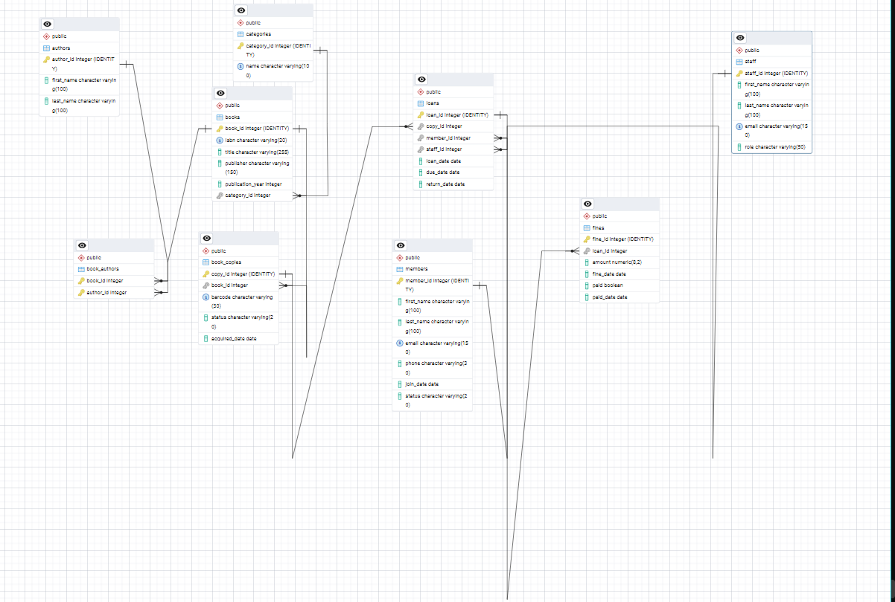

# Portfolio 1: Database Design and Modelling

## 1. Objective

To design a normalised relational database for CityLight Public Library, working from a conceptual model (ER diagram) to an implemented PostgreSQL schema with keys, constraints and sample data.

## 2. Case study

**CityLight Public Library** is a simulated public library. The database supports the catalogue, membership, borrowing and fines.

- **Users:** librarians (manage the catalogue, process loans and returns), members (search and borrow), administrators (reports).
- **Major data:** books and physical copies, authors, categories, members, staff, loans and fines.
- **Key operations:** search the catalogue, borrow a book, return a book, calculate overdue fines, and report on popular and overdue titles.

The full case study statement is in the [root README](../README.md).

## 3. Files

| File | Description |
|---|---|
| `er-diagram.png` | ER diagram generated from the implemented database using pgAdmin's ERD tool |
| `schema.sql` | `CREATE TABLE` statements with primary keys, foreign keys and constraints |
| `data.sql` | Data (INSERT statements) for all nine tables |
| `normalisation.md` | Normalisation walkthrough from an unnormalised record to 3NF/BCNF |
| `screenshots/` | Evidence of the implementation and verification checks |

## 4. How to run

**Tools:** PostgreSQL, with pgAdmin as the client.

1. In pgAdmin, create a database named `citylight_library`.
2. Open the Query Tool on that database and run `schema.sql`.
3. Run `data.sql` once, on the empty tables. It will fail if run twice, because of the UNIQUE constraints.
4. Check the load by running the row-count query below. The expected counts are: categories 5, authors 11, members 8, staff 3, books 12, book_authors 14, book_copies 20, loans 9, fines 2.

```sql
SELECT 'categories' AS tbl, COUNT(*) FROM categories UNION ALL
SELECT 'authors', COUNT(*) FROM authors UNION ALL
SELECT 'members', COUNT(*) FROM members UNION ALL
SELECT 'staff', COUNT(*) FROM staff UNION ALL
SELECT 'books', COUNT(*) FROM books UNION ALL
SELECT 'book_authors', COUNT(*) FROM book_authors UNION ALL
SELECT 'book_copies', COUNT(*) FROM book_copies UNION ALL
SELECT 'loans', COUNT(*) FROM loans UNION ALL
SELECT 'fines', COUNT(*) FROM fines;
```

To rebuild from scratch during testing, uncomment the `DROP TABLE` line at the top of `schema.sql` and rerun both scripts.

## 5. Design explanation

### 5.1 Entities and relationships

The database has nine tables.

| Table | Purpose |
|---|---|
| `categories` | Subject or genre of a book |
| `authors` | Book authors |
| `books` | A title in the catalogue (one record per title) |
| `book_authors` | Junction table between books and authors |
| `book_copies` | Physical copies of a title, each with its own barcode and status |
| `members` | People who borrow |
| `staff` | Librarians who process loans |
| `loans` | One borrowing event |
| `fines` | Overdue charges, at most one per loan |

| Relationship | Cardinality |
|---|---|
| category to books | one-to-many |
| books to authors | many-to-many (through `book_authors`) |
| book to copies | one-to-many |
| member to loans | one-to-many |
| copy to loans | one-to-many (over time) |
| staff to loans | one-to-many |
| loan to fine | one-to-zero-or-one |



*Figure 1: ER diagram generated from the implemented database. Note that the diagram shows tables and relationships but not CHECK constraints, which are described below.*

### 5.2 Keys

- **Primary keys:** every table has a surrogate integer key generated with `GENERATED ALWAYS AS IDENTITY`, apart from `book_authors`, whose primary key is the composite (`book_id`, `author_id`). I chose surrogate keys because they are compact, stable and never need to change.
- **Natural identifiers:** `email` (members and staff), `isbn`, `barcode` and category `name` are enforced with UNIQUE constraints, so duplicates are still prevented even though they are not the primary keys.
- **Foreign keys:** each relationship in the table above is enforced with a foreign key. Most use `ON DELETE RESTRICT`, so a member, book or copy with loan history cannot be deleted by accident and audit records are protected. The exception is `book_authors.book_id`, which uses `ON DELETE CASCADE` because a junction row has no meaning without its book.

### 5.3 Constraints and the business rules they enforce

| Constraint | Business rule |
|---|---|
| `chk_member_status` | A member is either `active` or `suspended` |
| `chk_copy_status` | A copy is `available`, `on_loan` or `lost` |
| `chk_publication_year` | Publication year must be between 1450 and 2100 |
| `chk_due_after_loan` | A due date must be after the loan date |
| `chk_return_after_loan` | A return date cannot be earlier than the loan date |
| `chk_fine_amount` | A fine must be a positive amount |
| `chk_fine_paid_consistency` | A fine marked paid must have a paid date, and an unpaid fine must not |
| `NOT NULL` on core columns | Required data such as names, emails, dates and foreign keys must be present |
| `UNIQUE` on `fines.loan_id` | A loan has at most one fine |

A `NULL` in `loans.return_date` deliberately means the book is still on loan. This makes "currently borrowed" and "overdue" queries straightforward.

### 5.4 Normalisation

I started from a flat loan record and normalised it to 3NF, and checked the result against BCNF. The full walkthrough is in [`normalisation.md`](normalisation.md). In summary:

- **1NF:** removed the repeating group of authors.
- **2NF:** removed partial dependencies by separating loan data from author data.
- **3NF:** removed transitive dependencies by creating separate tables for members, staff, copies, books, categories and fines.

### 5.5 Design decisions I made deliberately

1. **`books` is separate from `book_copies`.** The library may own several physical copies of one title, and the title details should be stored once. This also gives me a realistic "last available copy" scenario for the concurrency work in Portfolio 3.
2. **`book_copies.status` is intentionally redundant.** It can be derived from `loans`, but storing it makes availability a single-row check. The trade-off is that the two sources could disagree, so I wrote verification queries (below) to detect mismatches.
3. **`fines.amount` is stored, not calculated.** This preserves what was actually charged if the fine rate changes later. In the data the rate is 50 per overdue day.
4. **No rule yet prevents two open loans on the same copy.** I left this out on purpose, because Portfolio 3 demonstrates this exact problem under concurrency and then fixes it.

## 6. Evidence

| Screenshot | What it shows |
|---|---|
| `screenshots/01-tables-in-pgadmin.png` | The nine tables created in the `citylight_library` database |
| `screenshots/02-row-counts.png` | Row counts after running `data.sql`, matching the expected values |
| `screenshots/03-status-check-1.png` | Verification query 1 returning no rows: no copy is marked `on_loan` without an open loan |
| `screenshots/04-status-check-2.png` | Verification query 2 returning no rows: no open loan has a copy that is not marked `on_loan` |

Verification queries used for screenshots 03 and 04, both of which should return no rows:

```sql
-- Copies marked on_loan with no open loan
SELECT barcode FROM book_copies WHERE status = 'on_loan'
EXCEPT
SELECT c.barcode FROM loans l JOIN book_copies c ON c.copy_id = l.copy_id
WHERE l.return_date IS NULL;

-- Open loans whose copy is not marked on_loan
SELECT c.barcode FROM loans l JOIN book_copies c ON c.copy_id = l.copy_id
WHERE l.return_date IS NULL
EXCEPT
SELECT barcode FROM book_copies WHERE status = 'on_loan';
```

## 7. Testing

- I ran `schema.sql` on an empty database and confirmed that all nine tables were created.
- I ran `data.sql` and confirmed the row counts against the expected values.
- I ran the two consistency queries to confirm the data respects the design.
- I tested the constraints with deliberately invalid data, for example a loan whose due date is before its loan date, and confirmed that PostgreSQL rejected it.

## 8. Challenges and lessons

### Challenges

**1. Deciding how to model books and copies:**
My first instinct was a single `books` table with a status column. I realised that a library holds several physical copies of one title, and that a single table would repeat the title, ISBN and publisher for each copy. Splitting it into `books` (the catalogue record) and `book_copies` (the physical item) fixed this. It also made "availability" a property of the copy rather than the title, which is how a real library works.

**2. Creating tables in the right order:**
My first attempt to run the schema failed with a `relation "..." does not exist` error, because I had tried to create a table with a foreign key before the table it references. I fixed it by creating independent tables first (`categories`, `authors`, `members`, `staff`), then `books`, then the tables that depend on them (`book_copies`, `loans`, `fines`). This taught me that foreign keys create a dependency order, and that the same order applies when deleting or dropping tables.

**3. Identity columns and sample dat:.**
I defined the keys as `GENERATED ALWAYS AS IDENTITY`, so my first inserts that supplied IDs manually were rejected. The fix was to leave the ID columns out and let PostgreSQL assign them. That created a second problem: to insert loans and book-author links I did not know the generated IDs. I solved it by looking up IDs through natural keys such as ISBN, email and barcode inside the INSERT statements, which also made the script independent of what the IDs happened to be.

**4. Small data-loading errors:**
Two small things cost me time. Single quotes inside text, such as "Children's", have to be doubled (`''`) in SQL strings. Dates inside a `VALUES` list sometimes needed an explicit `::date` cast so PostgreSQL treated them as dates instead of text. Running the sample data script a second time also failed on the UNIQUE constraints, which was a useful reminder that my constraints were doing their job.

**5. Keeping `book_copies.status` consistent with `loans`.**
Storing a copy's status separately from its loan records means the same fact lives in two places, so they can disagree. I decided to keep the redundancy for fast availability checks, but I had to write verification queries to prove my sample data was consistent. I also realised this is a risk that transactions will need to control in Portfolio 3.

**6. Reading the generated ER diagram:**
The diagram generated by pgAdmin showed tables and foreign keys, but it initially looked cluttered and it does not show CHECK constraints. I rearranged the tables into logical groups (catalogue on one side, borrowing on the other) and documented the business rules in the README instead.

### Lessons learned

- **Design before code:** Thinking through entities, relationships and cardinalities first meant that writing the schema was mostly translation. The few problems I had were about SQL syntax, not about the design.
- **Constraints are part of the design:** CHECK, UNIQUE, NOT NULL and foreign key actions turn business rules into guarantees. Testing them with deliberately invalid data showed me that the database itself rejects bad data, not just the application.
- **Surrogate and natural keys do different jobs:** Generated integer keys are stable and compact, while UNIQUE natural identifiers (email, ISBN, barcode) prevent duplicates. Using both is better than choosing one.
- **Normalisation is a tool, not a rule to follow blindly:** Walking from a flat record to 3NF showed me how it removes update, insertion and deletion anomalies. It also showed me that sometimes a controlled denormalisation, such as the copy status or the stored fine amount, is justified, as long as I can explain the trade-off and check for inconsistencies.
- **Verify data with queries.** Row counts and consistency queries gave me evidence that the database matched my design, which is more reliable than assuming a script worked.*

## 9. Sources and AI use

- Tools: PostgreSQL and pgAdmin.
- All names, emails, phone numbers and ISBNs in the data are fictional placeholders.
- AI use is described in the AI Use Declaration in the final documentation (tool used, what it was used for, and how I reviewed and tested the output).
